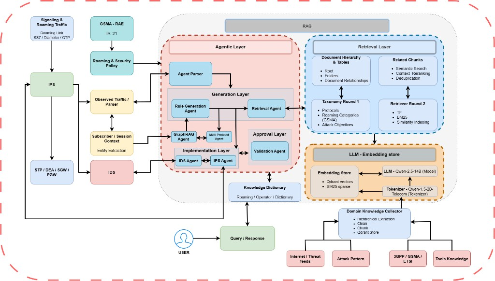

# A Knowledge-Grounded Agentic AI Framework for Multi-Protocol Telecom Signaling Security

Telecom interconnects carry multi-protocol signaling (SS7/MAP, Diameter, GTP-C)
that attackers increasingly chain across layers. This repository implements a
**knowledge-grounded agentic** stack that inspects traffic with GSMA-aligned
**CAT1 / CAT2 / CAT3** engines, correlates cross-protocol events on subscriber
identity, retrieves domain knowledge (standards, IR.21 policy context, attack
patterns), and supports **assessment and Suricata rule generation**—matching the
system described in the accompanying IEEE Access manuscript.

---

## System architecture



The figure shows the end-to-end flow: observed signaling and roaming policy enter
an **agentic layer** (parser, multi-protocol / GraphRAG / rule-generation agents,
IDS–IPS implementation, validation), backed by a **retrieval layer** and an
**LLM–embedding store** (Qwen instruct + telecom tokenizer, Qdrant / BM25), with
a domain knowledge collector and operator-facing query interface.

---

## Capabilities

| Capability | Description |
| --- | --- |
| **CAT1 → CAT2 → CAT3** | Policy, IR.21 context, and stateful mobility inspection |
| **Multiprotocol correlation** | IMSI-linked SS7 / Diameter / GTP chains (e.g. AIR→ULR→CSR) |
| **Assessment & rules** | Severity assessment and Suricata drafting |
| **Agentic RAG** | Retrieval-augmented telecom security reasoning |

```
message → CAT1 → CAT2 → CAT3 → store event
        → correlate by IMSI → match DR006–DR008 → assess → Suricata rules
```

| Layer | Path |
| --- | --- |
| IDS engines | `app/ids/` |
| Agents / correlation | `app/agent/` |
| Ontology / rules | `app/ontology/` |
| Retrieval | `app/retrieval/`, `shared/` |
| API / UI | `app.py`, `frontend/` |
| Reproduce | `test/reproduce.py` |
| Benchmarks | `evaluation/questionnaire_250.json` |

---

## Reproduce

`test/reproduce.py` is the single offline check used to confirm that this
checkout still implements the paper’s core software claims—without API keys or
model weights.

**Results it verifies**

| Check | What it reproduces from the work |
| --- | --- |
| Benchmark questionnaire integrity | **250-question** multi-protocol telecom security suite (9 categories: standards, policy, protocols, IR.21, Suricata/IDS, attacks, rule drafting, investigation, live IDS/case studies) |
| Answer-shape / intent logic | Structured response profiles used by the agentic RAG path (definition, enumeration, parameters) on representative SS7 / Diameter / GTP questions |
| CAT1–CAT3 stack availability | Import and wiring of the knowledge-grounded IDS category engines used for multi-protocol inspection |

```bash
python -m venv .venv && source .venv/bin/activate
pip install -r requirements.txt
python test/reproduce.py
```

**Expected output**

```
Reproduce — Knowledge-Grounded Agentic AI for Multi-Protocol Signaling Security

  questionnaire OK — 250 questions, 9 categories
  answer-shape fixtures OK — 3 cases
  IDS category stack import OK (CAT1/CAT2/CAT3)

PASS — reproduction checks succeeded.
```

A `PASS` means the published artifact still exposes the questionnaire, agent
intent logic, and CAT1–CAT3 inspection stack that underpin the framework’s
reported multi-protocol signaling-security behaviour.

---

## Run the platform

```bash
cp .env.example .env
docker compose up -d
# optional local LLMs: see models/README.md
cd frontend && npm install && npm run build && cd ..
python app.py    # http://127.0.0.1:8000
```

**Requirements:** Python 3.10+, Node 18+, Docker (recommended).

---

## Cite

```bibtex
@software{ali_knowledge_grounded_signaling_security,
  author    = {Ali, Muhammad Haris and Rehman, Altaf ur},
  title     = {A Knowledge-Grounded Agentic AI Framework for Multi-Protocol Telecom Signaling Security},
  year      = {2026},
  publisher = {GitHub},
  url       = {https://github.com/muhamamdharrisali255/A-Knowledge-Grounded-Agentic-AI-Framework-for-Multi-Protocol-Telecom-Signaling-Security}
}
```

MIT License — see `LICENSE`. Update `CITATION.cff` when the IEEE Access DOI is available.
